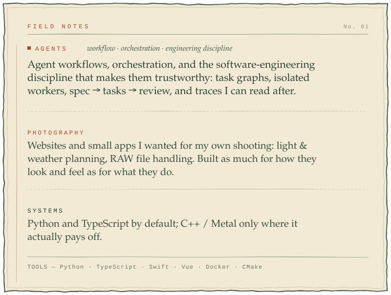
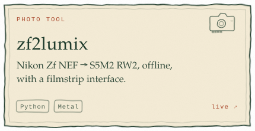

<!--  GitHub Profile README · JAY201368
      设计语言：深绿墨色 + 米色纸 + 赭红印章，手绘描边。
      所有图都是本仓库自绘的 SVG，改文案/配色请改 tools/build_assets.py 后重新生成：
          python3 tools/build_assets.py  -->

  

  

## What I work on

## Selected work

  

  

  

  

## Numbers

  

  

  

